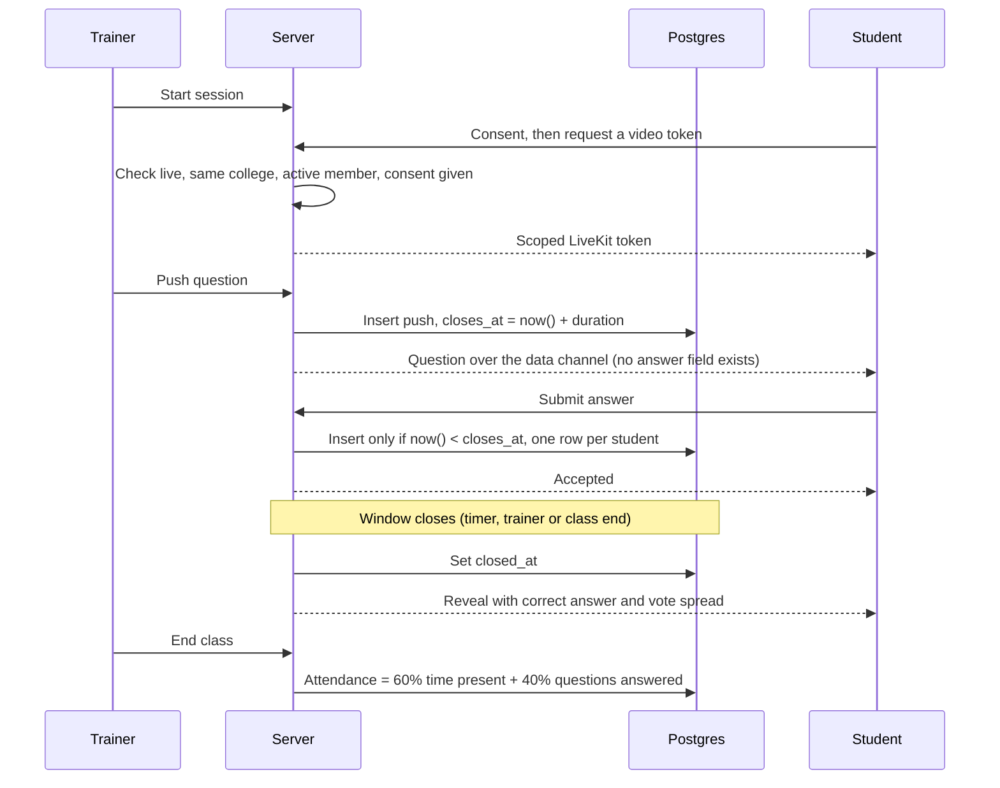

# Vidyaan

**A live training and placement platform for colleges.**

A trainer runs a class, pushes a question in the middle of it, every student answers on their own phone, and sees right or wrong the moment the timer ends. Attendance and scores are ready when the class ends. Nobody fills a sheet.

The same core also runs timed online assessments: hundreds of students take a proctored test on their own devices, and the trainer gets scores and an integrity report the moment it closes.

**Live:** [vidyaan.online](https://vidyaan.online)

| | |
|---|---|
| **In production** | 1,000+ accounts, real students, real payments |
| **Used by** | Training and Placement Office, Sinhgad Institute of Technology, Lonavala |
| **Two modes** | Live classes (up to 100 students in one class) and online assessments (500+ students taking one test live) |
| **Load tested** | 500+ students submitting at the same moment |
| **Usage** | 2,000+ mock test attempts and 115,000+ saved answers (as of 12 Oct 2026) |
| **Built by** | One developer, 164 commits in 5 weeks |
| **Stack** | Next.js 15, React 19, TypeScript, Postgres, LiveKit, Razorpay |

The source code is private because the product holds real students and real payments. This repo is the tour: what it does, how it is built, and the parts of the code I am happiest with.

---

## Why I built it

Placement training in most colleges runs on a whiteboard, a Google Form and a WhatsApp group. The placement cell cannot tell who attended, who understood the topic, or who is quietly falling behind.

I wanted one place where the trainer teaches, checks understanding while the class is still running, and the college gets numbers it can act on. The Training and Placement Office at Sinhgad Institute of Technology, Lonavala was the first to use it, and their students now take live classes, mock tests and online assessments on it.

---

## What it does

**Live class.** Video through LiveKit. The student always controls their own camera and mic. A consent screen decides whether the trainer is allowed to switch them on or off, and that rule is enforced on the server, not just hidden in the UI. Class modes (open, focused, listen only), raise hand, grant the floor, and chat on the same data channel as the quiz. Big batches switch to listen only automatically.

**Quiz push.** The trainer pushes a question with a countdown. Each student answers once. The right answer never reaches a browser until the window closes. Then the answer and the distribution of votes are broadcast to everyone.

**Mock tests and online assessments with proctoring.** Server timed and server graded. Every student gets a different question order. Camera, face presence, tab switches and fullscreen exits are logged and shown to the trainer as an integrity report. Trainers can run a test as a confidential online assessment, with an optional leaderboard.

**Coding practice.** C++, Java, JavaScript and Python in an in browser editor. Code runs in the browser, so untrusted code never runs on my server. This is practice, not a secure judge, and I say so on purpose.

**AI mock interviews.** Spoken interview, follow up questions based on the student's actual answer, and a scored report. Every AI reply is validated against a schema before it touches the database, usage is capped per day, and there is a fixed question bank fallback when AI is off.

**Points and leaderboard.** An append only ledger, so a points award can never be applied twice. Levels, badges, and a leaderboard per batch.

**Discussions and assignments.** Threaded discussions per batch. Assignments with deadlines. Late submissions are flagged, not blocked.

**Payments.** Razorpay Checkout, server side signature verification, signed webhook, plans and paid batches with a seat limit and an audit trail.

**Multi college.** Many colleges on one deployment, each fully separated.

**Installable.** PWA with offline page, and an Android app built with Capacitor from the same codebase.

---

## How a live class works



A student who joins late, or whose phone drops off the network, asks the server for the current question and gets the open one, or the last reveal if it just closed.

## How the app is put together

```
Browser
  -> Edge middleware: coarse check, redirects signed out users
  -> Panel layout: one live auth check, then the role is read from our own users table
  -> Page or API route: input validated with Zod
  -> Drizzle query, always scoped by college_id
  -> Postgres
```

- One Next.js codebase serves the marketing site, three role panels (student, trainer, admin) and the API.
- Supabase Auth only stores credentials. Roles live in my own `users` table, so no token claim can ever grant access.
- Every table except `colleges` carries a `college_id`, and every query is scoped by it.
- Row Level Security is switched on for the whole schema with no policies, and the app talks to the database only from the server. Browsers have no route to the tables.

---

## Decisions I would defend

**The server owns the clock.** Quiz windows and test deadlines are checked with the database `now()` inside the write itself. A client timestamp is never trusted. A student cannot beat the timer by changing their device clock, and a slow phone is not punished for a slow request.

**Payments are built to be retried.** The checkout callback and the Razorpay webhook can both arrive for the same payment, in any order. Activation takes a per payment lock and writes a marker in the same transaction, so a student is granted access exactly once. If activation fails, the webhook answers 500 so Razorpay delivers it again. The signature is verified on the raw request body with a constant time compare.

**One answer per student is a database rule, not an if statement.** A unique index on (push, student) rejects the second answer, even when two requests race.

**The rate limiter lives in Postgres.** I did not want a new vendor for five endpoints. It is a fixed window counter, applied only to public routes, and it fails open. A limiter must never be the reason a student cannot submit a test.

**Bad networks are a normal case.** In a college lab, wifi drops. Answers go through a small queue that keeps the latest answer per question, mirrors to session storage so a reload loses nothing, and retries quietly. Submit also carries any unsaved answers.

**The service worker must never cache auth pages.** A real bug: the registration finish page showed up blank for some users. The service worker was caching a personal, session dependent page and serving a stale copy. Fix: a tested denylist that the worker checks first.

Code and short write ups for each are in [docs/engineering-highlights.md](docs/engineering-highlights.md).

---

## Numbers

Counted from the codebase on 27 Oct 2026.

| | |
|---|---|
| Database tables | 49 |
| SQL migrations | 27 |
| API route handlers | 114 |
| Pages | 93 |
| React components | 151 |
| TypeScript | about 84,500 lines in 694 files |
| Test declarations | 294 across 39 files |
| Commits | 164 |

## Stack

| | Why |
|---|---|
| Next.js 15, React 19, TypeScript strict | One codebase for site, panels and API. Role checks and data access stay on the server. |
| Tailwind v4 with design tokens | A build step fails the PR if a raw colour or arbitrary size sneaks in. |
| Postgres on Supabase, Drizzle ORM | Real SQL where correctness depends on the database clock. Typed schema, committed migrations. |
| Supabase Auth | I did not want to own password storage. |
| LiveKit | Video and one data channel for quiz and chat. No second realtime vendor. |
| Razorpay | Indian payments. A thin REST wrapper keeps the signature logic small and testable. |
| Zod | Strict shapes on every request and every AI reply. |
| Anthropic SDK | AI interviews and question generation, behind a feature flag and a daily token cap. |
| TensorFlow BlazeFace | Face presence for proctoring, in the browser, no video upload. |
| CodeMirror, Web Worker, Pyodide | Code runs in the browser. |
| Serwist, Capacitor | PWA and Android app, no second codebase. |
| Sentry | Error tracking with personal data scrubbed. |
| Vercel, GitHub Actions, pnpm | Deploys from main. |

## Quality gates

- Every push runs typecheck, lint, the design token check and a production build in GitHub Actions. Main only deploys when it is green.
- 294 tests cover the parts where a mistake costs money or trust: webhook handling, secret comparison, the answer queue, the rate limiter, CSV export, auth error mapping, paging, and the service worker denylist. They run in the local verify command before I push.
- Database changes are additive migrations, written first and applied to production only after a dry run.

## Load test

I ran a load test with more than 500 students submitting a quiz answer at the same moment. Result: zero duplicate answers, zero ungraded answers, zero database errors. The one answer rule held.

Latency did not meet my target at that size. The test ran on free tier Supabase, and auth calls and the connection pooler were the bottleneck. I capped the pool per instance and moved the auth check to one call per request afterwards. Correct under load, not fast enough at that size on the free tier, and I know why.

## Honest limits

- Coding practice runs in the browser, so results are reported by the client. It is for practice, not for a high stakes exam.
- Proctoring deters and records. It does not prove someone did not cheat.
- Live video was never load tested beyond the free tier limits.
- Single developer, no external security audit.

---

## What this project shows

- **Payments done carefully.** Signature checks on the raw body, constant time compare, idempotent activation, retry safe webhooks, seat limits and an audit trail.
- **Correctness under concurrency.** Database clock as the authority, unique indexes as the rule, writes that cannot race.
- **Production habits.** Additive migrations, CI gates, error tracking with scrubbed data, rate limits that fail open, honest load test notes.
- **Full ownership.** Product, database, backend, frontend, mobile app, deployment and support, for real users, by one person.

---

## About

I am Vishal Ghuge, founder and sole developer of Vidyaan.

- GitHub: [VishalGhuge111](https://github.com/VishalGhuge111)
- Product: [vidyaan.online](https://vidyaan.online)
- Contact: [vidyaan.online/contact](https://vidyaan.online/contact)

The source is private. I am happy to do a live demo or walk through any part of the code on a call.
